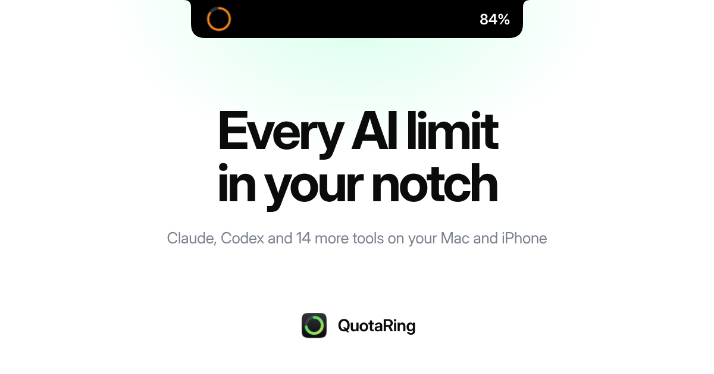
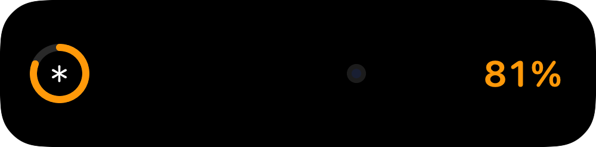
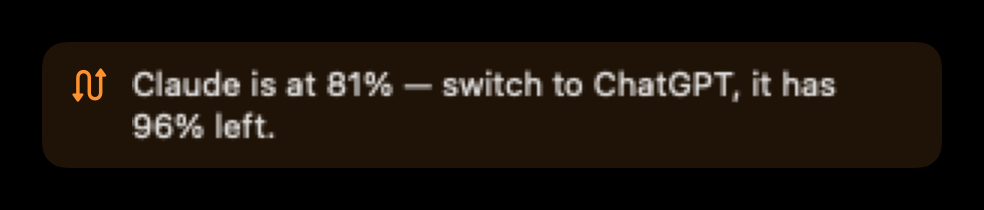
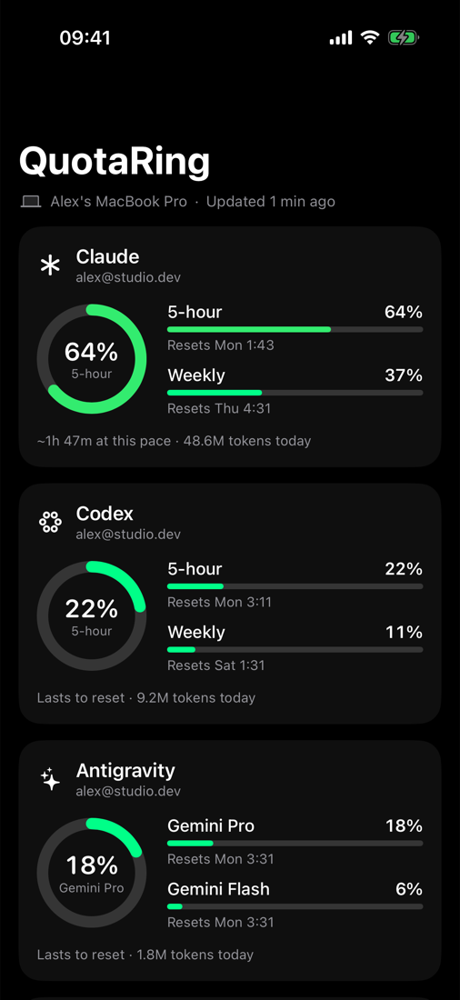
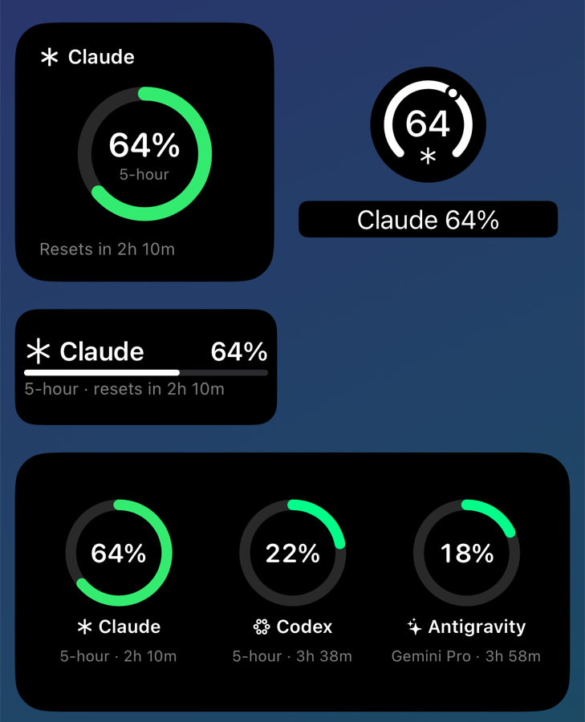

<p align="center">
  
</p>

<p align="center">
  <a href="https://github.com/batuhan-sahinoglu/quotaring-releases/releases/latest/download/QuotaRing.dmg"></a>
  <a href="https://quotaring.app/#pricing"></a>
</p>

<p align="center">
  <a href="https://github.com/batuhan-sahinoglu/quotaring-releases/releases/latest"></a>
  
  
  <a href="https://github.com/batuhan-sahinoglu/quotaring-releases/releases"></a>
</p>

<p align="center">
  <a href="https://quotaring.app">Website</a> ·
  <a href="https://quotaring.app/release-notes">Release notes</a> ·
  <a href="mailto:support@quotaring.app">Support</a>
</p>

---

**QuotaRing** shows the usage limits of Claude, Codex and 14 more AI tools in your MacBook's notch and on your iPhone. You see when each limit resets, how long it lasts at your pace and which tool still has room.

This repository holds the signed, notarized builds and the update feed. The app itself is closed source.

<p align="center">
  
</p>

## Install

1. **[Download QuotaRing.dmg](https://github.com/batuhan-sahinoglu/quotaring-releases/releases/latest/download/QuotaRing.dmg)**. It is always the newest version.
2. Open it and drag **QuotaRing** into **Applications**.
3. Open QuotaRing. It reads the sign-ins already on your Mac, so Claude Code, Codex, Antigravity and Cursor need no setup. It's free for one tool, with no key and no sign-up.

Requires **macOS Sonoma 14.0 or later**. On a Mac without a notch, QuotaRing draws the same pill at the top of the screen. The menu bar, Dock panel and floating rings work on every Mac.

## Free and paid plans

QuotaRing is free for one tool: the one you use most, with one account, in the notch and the menu bar, with reset times, the pace forecast, alerts and which sessions used Claude's 5-hour limit. A paid plan adds more tools and accounts, the iPhone app, the Dock and floating rings, recaps and trophies, which sessions used the weekly limit, agent alerts, the status line and the MCP server.

After you [buy a plan](https://quotaring.app/#pricing), Polar emails you a receipt with your license key. You can also find the key any time in the [customer portal](https://polar.sh/hicupertiny/portal).

Open QuotaRing → **Preferences → License**, paste the key into **Have a key?** and click **Activate**.

| Plan | Price | Tools | Macs |
|---|---|---|---|
| Free | $0 | 1 | Any |
| Personal | $15 | 2 | 1 |
| Plus | $29 | 4 | 3 |
| Pro | $49 | Every tool, as they're added | 5 |

Every paid plan is a one-time payment with unlimited accounts per tool, the iPhone app included and a **14-day money-back guarantee**. To upgrade, buy the higher plan and paste its key.

## What it does

- **Every limit at a glance.** The notch, menu bar, Dock panel or a floating ring rail. Each window shows its reset time and a forecast at your pace.
- **Which tool still has room.** When one tool runs low, QuotaRing tells you which one to switch to.
- **Alerts that matter.** Warnings at your thresholds, and a notice when a limit you hit resets.
- **Tokens and API value.** Today, this week and this month, broken down by model.
- **Which sessions used your limit.** Every Claude Code session in the current 5-hour or weekly window, with its tokens and about how much of the limit it took.
- **Weekly reports and monthly recaps.** Levels and 127 trophies to chase.
- **For your coding agents.** Claude Code's status line, an MCP server (`get_quota_status`, `suggest_tool`) and a global shortcut.

<p align="center">
  
</p>

### On your iPhone

The iPhone app is included with every paid plan. It shows every tool and reset your Mac sees, with Home and Lock Screen widgets, a Live Activity and the Dynamic Island. It syncs through your private iCloud.

<p align="center">
  
  &nbsp;&nbsp;
  
</p>

### Supported tools

Claude Code · Codex · Antigravity · Cursor · GitHub Copilot · OpenRouter · DeepSeek · Moonshot · Kimi · Grok · Amp · OpenCode · GLM (Z.ai) · Kilo · Devin · Command Code

## Updates

QuotaRing updates itself through [Sparkle](https://sparkle-project.org). It checks once a day, or choose **Check for Updates…** in Preferences. Every update is signed with an EdDSA key and checked against the signature in `appcast.xml` before it installs.

| File | What it is |
|---|---|
| `QuotaRing-<version>.dmg` | Each release, signed with a Developer ID and notarized by Apple |
| `appcast.xml` | The Sparkle feed installed copies read |
| [Releases](https://github.com/batuhan-sahinoglu/quotaring-releases/releases) | The same builds, with `QuotaRing.dmg` always pointing at the newest |

To check a download yourself:

```sh
spctl -a -t open --context context:primary-signature -vv QuotaRing.dmg
# QuotaRing.dmg: accepted
# source=Notarized Developer ID
```

## Release notes

### 1.3 · Anonymous usage data

- Anonymous usage data: QuotaRing now sends a daily, anonymous count of active Macs with your plan, version, connected tools and surfaces, plus taps on a few features, to its own self-hosted analytics. Never accounts, projects, sessions, prompts or usage numbers. Switch it off any time in Preferences → General → Privacy.

### 1.2.1 · October 24, 2026

- QuotaRing uses far less energy while your agents work. Every time Claude Code, Codex or Antigravity wrote to a session, QuotaRing rechecked every trophy against your whole usage history, up to four times over, working out the day and week of each reading one by one. With a month of history that showed up as bursts of 10–30% CPU for as long as an agent was working. Trophies are now checked at most once a minute, each check does its date math once per day rather than once per reading, and a new trophy still unlocks within a minute.

### 1.2 · October 24, 2026

- See which sessions used Claude's limit. Under Claude, the notch and the menu bar list every Claude Code session on your Mac that worked in the current window, finished ones too, biggest first, with its project and branch, its tokens and about how much of the limit it took.
- Switch between the 5-hour and the weekly window. The 5-hour split is on every plan, Free included. The weekly split comes with a paid plan.
- Anthropic reports one figure for the whole account, so each share is an estimate, split by each session's token value. Use on claude.ai or another device counts toward the limit but leaves no session on your Mac, so it's spread across your Mac's sessions.

### 1.1 · October 24, 2026

- QuotaRing is free for one tool. Without a key it shows the tool you use most, with one account, in the notch and the menu bar, with reset times, the pace forecast and alerts.
- A paid key adds more tools and accounts, the iPhone app and its widgets, the Dock and floating rings, recaps, levels and trophies, agent alerts, the status line and the MCP server.
- A license that expires or can't be confirmed for 30 days now drops to the Free plan instead of locking QuotaRing.
- When another tool is on your Mac, the notch and the menu bar say so, with a link to the plans.

### 1.0.2 · October 24, 2026

- Claude keeps updating on Macs where you only use the Claude app. When Claude Code's sign-in expires, QuotaRing asks Claude Code to renew it. No message goes to a model and nothing shows up in your sessions.
- Codex no longer reports a sign-out when it has simply sat unused. The last reading stays and updates the next time Codex runs.

### 1.0.1 · October 24, 2026

- Claude no longer reports a sign-out when Claude Code's session has simply expired. The last reading stays and updates the next time Claude Code runs.
- The menu bar drops "Why this tool?". The suggestion to switch still appears when a limit runs short, and the reasoning is in Preferences → Status.

### 1.0 · October 23, 2026

The first release.

- Usage limits for 16 AI tools in the notch, menu bar, Dock panel and a floating ring rail
- Reset times and a forecast of how long each limit lasts at your pace
- A suggestion for which tool still has room
- Custom alert thresholds and a notice when a limit you hit resets
- Unlimited accounts per tool, using the sign-ins already on your Mac
- Tokens by model and their API value
- Weekly reports, monthly recaps, levels and trophies
- iPhone app with widgets, Live Activity and the Dynamic Island
- Claude Code status line, an MCP server and a global shortcut
- Automatic updates

Every version is listed at [quotaring.app/release-notes](https://quotaring.app/release-notes).

## Privacy

Usage checks go only to each tool's provider, and your history and credentials stay on your Mac. iPhone sync uses your private iCloud. Licenses go through Polar and updates come from this repository. The Mac app also sends a few anonymous usage events (no accounts, projects or usage numbers) to QuotaRing's own analytics, and you can switch that off in Preferences → General → Privacy. QuotaRing has no server of its own for your usage. Details: [quotaring.app/privacy](https://quotaring.app/privacy).

## Support

Write to **[support@quotaring.app](mailto:support@quotaring.app)**, or use **Send Feedback** in the app. It attaches crash reports only if you choose to send them.

[Terms of service](https://quotaring.app/terms) · [Privacy policy](https://quotaring.app/privacy) · [Customer portal](https://polar.sh/hicupertiny/portal)

---

<sub>© 2026 QuotaRing by zenora.studio. Not affiliated with Anthropic, OpenAI, Google or any other provider. Product names belong to their owners.</sub>
